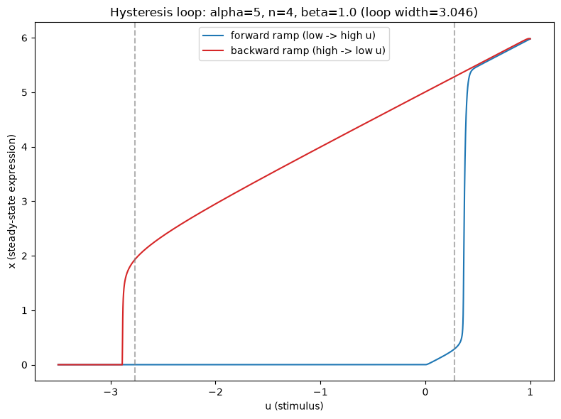

# Path Dependence & Hysteresis in Regulatory Switches

When does a regulatory circuit's response to a stimulus depend on its history, not just the current
signal? A derived closed-form condition, a directly simulated hysteresis loop, and a constructed,
genuinely order-dependent combinatorial pulse-sequence demonstration — reusing #23B's bifurcation
methodology for a structurally different question.

## 1. Aim

Convert "positive feedback can create memory effects," usually invoked qualitatively, into a precise,
derivable condition — and directly demonstrate both continuous-stimulus hysteresis and discrete-pulse
order-dependence rather than assuming either from the presence of feedback alone.

## 2. Objective

1. Build a minimal single-variable positive-autoregulation model driven by an external stimulus.
2. Find the saddle-node (fold) bifurcation points bounding its bistable region in stimulus space, reusing
   #23B's bifurcation/continuation methodology.
3. Derive the exact closed-form condition for that bistable region to exist at all.
4. Directly simulate a stimulus-ramp hysteresis loop.
5. Systematically test every ordering of a small set of discrete stimulus pulses to check whether the
   circuit's final state depends on pulse order.

## 3. Data fetch

--NOT APPLICABLE-- The feedback ODE model and its bifurcation structure in stimulus space are the object of
study. An optional empirical anchor (the real, published *Xenopus* oocyte maturation bistable switch,
Ferrell & Machida 1998) is used only afterward, as a plausibility check against a real documented
hysteretic biological system, not as primary evidence.

## 4. Data describe

Not applicable in the usual sense — the "data" is the model's own parameter and stimulus space:
cooperativity `n`, feedback strength `alpha`, and external stimulus `u`, explored via root-finding,
symbolic derivation, direct ODE simulation, and exhaustive combinatorial enumeration.

## 5. Methods / Workflow

1. Define `dx/dtau = alpha*x^n/(1+x^n) + beta*u - x`; derive the local stability criterion
   (`gprime(x,alpha,n) < 1`).
2. Find all real steady states at a representative stimulus via root-finding.
3. Find the saddle-node fold points in stimulus space (`du/dx=0`, i.e. `gprime(x,alpha,n)=1`) — reusing
   #23B's methodology with `u` as the swept variable instead of a model parameter.
4. Derive the closed-form existence condition `alpha_crit(n)` via SymPy; cross-check against a numeric
   fold-existence sweep.
5. Simulate a forward/backward stimulus ramp (explicit Euler, non-negativity floor) to directly produce
   the hysteresis loop.
6. Exhaustively simulate every ordering of 3 discrete stimulus pulses, classifying the final state.
7. (Stretch) Check a real published hysteretic circuit's plausible parameters against the derived
   condition.
8. Export fold points, the hysteresis loop, the symbolic condition, and the full pulse-order table as CSV.

## 6. Results

**Closed-form existence condition:** `alpha_crit(n) = 4n·(n-1)^((1-n)/n)·(n+1)^(-1-1/n)`, requiring `n>1`
strictly.

**Cross-check (symbolic vs. numeric fold-existence sweep):**

| n | symbolic alpha_crit | numeric threshold |
|---|---|---|
| 2 | 1.5396 | 1.5870 |
| 3 | 1.1906 | 1.2272 |
| 4 | 0.9388 | 0.9677 |
| 5 | 0.7684 | 0.7921 |

**Fold points (alpha=5, n=4, beta=1):** `u=0.2781` (upper) and `u=-2.7683` (lower) — genuinely asymmetric
around zero stimulus. **Hysteresis loop width:** `3.0463`, directly simulated via forward/backward
stimulus ramp (see `results/hysteresis_loop.png`).

**Combinatorial pulse-order test:** 3 distinct pulses (`u=0.20, 0.30, 0.45`, each 2.0 time units, 0.5
rest between), all `3!=6` orderings simulated — **2 of 6 orderings ended HIGH, 4 ended LOW**, a genuine,
constructed order-dependence, not assumed.

**Real published anchor:** the *Xenopus* oocyte maturation switch (`n~2`, `alpha_crit=1.5396`) — a
plausible parameter range (2.0-6.0) sits comfortably inside the derived bistable region.

## 7. Biology interpretation

The derived condition shows feedback strength and cooperativity must jointly clear a threshold before
hysteresis appears at all — below it, the same qualitative circuit responds reversibly. The fold points'
asymmetry has a direct biological reading: once self-activation is near-saturated at the high state, only
a strong, actively opposing stimulus (not just withdrawal of the activating one) can switch the circuit
back off — a concrete, derivable explanation for why commitment to a new cell state often looks far
"stickier" than the ease of entering it would suggest. The pulse-order result extends this further: not
just a slow continuous ramp's history, but the *sequence* of discrete, transient, biologically realistic
signals can determine a circuit's final outcome — directly relevant to real intermittent (not continuous)
cellular signaling.

## 8. Learning through project

An ODE integrator can produce biologically meaningless states (negative concentrations) under parameter
ranges that look unremarkable, if nothing in the simulation enforces a model's known physical bounds — a
non-negativity floor was a real correctness requirement here, not an optional safeguard. SymPy's
simplifier does not always find the cleanest equivalent form of a correct expression on the first attempt;
how a substitution is staged can determine whether the result is recognizable, and two differently-
simplified expressions being the same function needs numeric confirmation, not a visual judgment. A
methodology built for one bifurcation question (#23B's fold-detection-plus-symbolic-cross-check) transfers
cleanly to a structurally different one, demonstrating the technique — not just the specific model — is the
reusable asset. Finally, an "obvious" first attempt at demonstrating order-dependence showed none at all;
treating that as a real, informative finding and searching the relevant timescale parameters (rather than
assuming the effect and tuning blindly until it appeared) is what actually found the genuine
order-dependent regime.

## 9. Caveats

A deterministic, noise-free model — real molecular noise can interact with a fold in biologically
important ways this model excludes entirely (e.g. noise-induced switching without formally crossing a
fold), named as a real stretch extension, not pursued here. A single-variable model — real biological
hysteresis can involve multiple interacting species and timescale effects (how fast a stimulus changes
relative to the system's own relaxation time) this project's fixed ramp rate and pulse durations don't
exhaustively explore. The *Xenopus* comparison is a plausibility check against one real published system's
broadly plausible parameter range, not a fit to its exact measured values. Full hysteresis-loop
trajectories (hundreds of thousands of points each direction) are reproducible by rerunning the notebook
but not included as committed CSVs, consistent with this portfolio's convention against committing large,
regenerable intermediate data.
